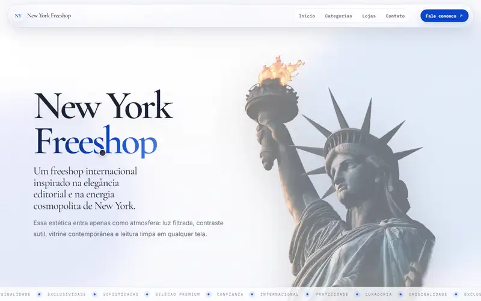

# Catálogo NY

> Single-page institutional site and product catalog for a multi-branch perfumery retailer in Uruguaiana, RS (Brazil).


The site presents the brand, its physical stores and a searchable product catalog, with a focus on visual polish and performance on mobile. The UI is in Brazilian Portuguese.

**Live site:** https://catalogo-ny.vercel.app



<sub>Walkthrough of the live site (sped up 2x). [Full-quality video](docs/demo.mp4).</sub>

## What it does

- **Hero with parallax and ticker**, smooth scrolling powered by [Lenis](https://github.com/darkroomengineering/lenis).
- **Searchable catalog** organized by brand, with debounced search and an image lightbox.
- **Stores showcase** with per-branch address, photo and accent color.
- **Responsive navigation** with a mobile menu and a footer reveal animation.
- **Image pipeline:** build-time scripts optimize UI images into responsive `srcset` WebP sets and sync product images against a manifest.

## How it works

The app is a single-page site. Store data and the fallback catalog are local TypeScript modules; when `VITE_API_URL` is set, the catalog is loaded from the Estoque API (`GET /public/catalog`) and replaces the fallback, which is used again if the API fails or takes over 4 s. A `CatalogContext` exposes the catalog to the UI, and hooks hold the interactions (search, lightbox, parallax, smooth scroll, stores showcase).

```text
src/
  components/   hero, catalog, stores, layout (nav, mobile menu), footer
  hooks/        useProductSearch, useDebouncedValue, useLightbox, useHeroParallax,
                useLenisSmoothScroll, useMobileMenu, useStoresShowcase, ...
  context/      CatalogContext
  services/     catalogService (+ tests)
  data/         catalog and stores data
  models/       TypeScript models
  pages/        HomePage
  routes/       AppRoutes
scripts/        sync-product-images.cjs, optimize-ui-images.cjs
data/           image manifest and product image sources
```

## Tech stack

| Layer   | Technology                                                                                       |
| ------- | ------------------------------------------------------------------------------------------------ |
| App     | React 19, TypeScript, Vite, React Router 7                                                       |
| Motion  | Framer Motion, [Lenis](https://github.com/darkroomengineering/lenis) smooth scroll               |
| Images  | Build-time optimization with [sharp](https://sharp.pixelplumbing.com) (responsive `srcset` WebP) |
| Tests   | Vitest                                                                                           |
| Hosting | Vercel (static SPA)                                                                              |

## Getting started

```bash
npm install
npm run dev
```

Optional environment variables (see `.env.example`): `VITE_WHATSAPP_NUMBER` for the contact link and `VITE_API_URL` for the Estoque API base URL (for example `http://127.0.0.1:8010`). Without `VITE_API_URL` the site uses only the static catalog.

| Command                       | Description                             |
| ----------------------------- | --------------------------------------- |
| `npm run dev`                 | Start the Vite dev server               |
| `npm run build`               | Type-check and build for production     |
| `npm run preview`             | Preview the production build            |
| `npm test`                    | Run the Vitest suite                    |
| `npm run sync:product-images` | Sync product images with the manifest   |
| `npm run optimize:ui-images`  | Generate optimized responsive UI images |

## Quality checks

```bash
npm test        # Vitest (catalog service)
npm run build   # type-check + production build
```

## Deployment

The app is a static SPA: `vercel.json` publishes `dist/` and rewrites every route to `index.html`.

## Status

In production at the link above. Products come from the companion inventory system (Estoque NY) through a read-only public feed, with the bundled catalog as a fallback. Who owns what, what is public, how the contract is versioned and what happens when the API fails are in [ADR 0001](https://github.com/LorenzoMarty/Estoque-NY/blob/master/docs/adr/0001-catalog-contract.md).

## License

[MIT](LICENSE)

## Author

**Lorenzo Marty** — [GitHub](https://github.com/LorenzoMarty)
